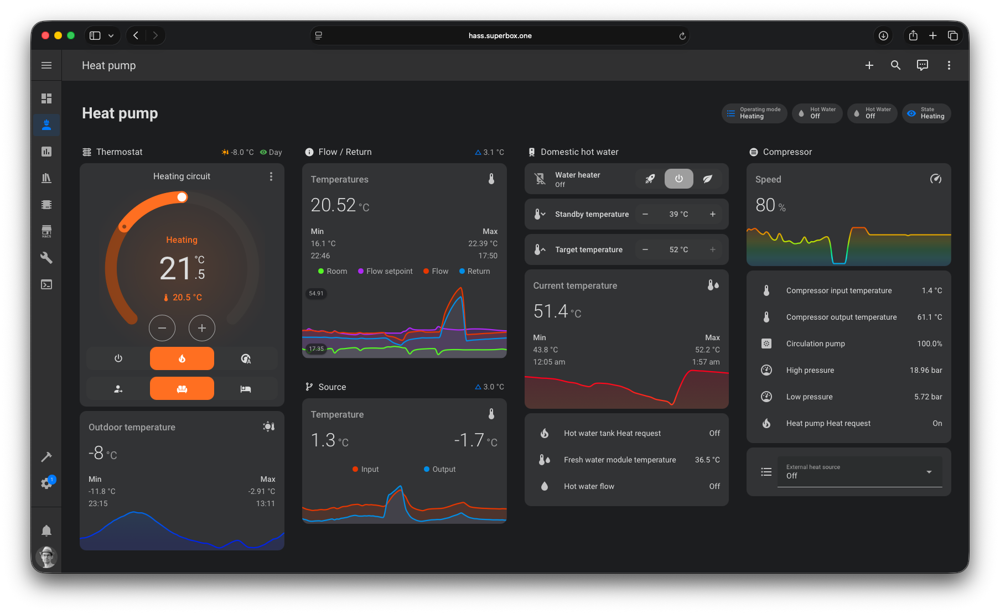

# KEBA KeEnergy

A Home Assistant integration for heat pumps with a KEBA KeEnergy control unit. It exposes the values of the Web HMI
as Home Assistant entities to monitor and control heat pumps, heating circuits, hot water tanks, buffer tanks, solar
circuits, external heat sources and photovoltaics. It is used with heat pumps from M-TEC, ino and Windhager.

> [!NOTE]
> This is an unofficial integration. It is not affiliated with or supported by KEBA.

## Installation

[][redirect-hacs]

1. Go to **Settings** → **Marketplace**, search for **KEBA KeEnergy** and select **Install**.
2. Follow the setup that starts after the installation.

Requires network access to the Web HMI of the control unit. See the
[installation](https://superbox-dev.github.io/keba_keenergy/#installation) and
[configuration](https://superbox-dev.github.io/keba_keenergy/#configuration) sections for a manual
installation and all parameters.

[redirect-hacs]: https://my.home-assistant.io/redirect/hacs_repository/?owner=superbox-dev&repository=keba_keenergy&category=integration

## Documentation

**[Read the documentation](https://superbox-dev.github.io/keba_keenergy/)** for supported devices, options,
entities, actions, examples and troubleshooting.

## Changelog

The [changelog](https://superbox-dev.github.io/keba_keenergy/changelog) lists the new features, changes and fixes of
every release. Check it before you update the integration.

## Get involved

[][workflow-ci]

![Typing: strict][typing-strict]
![Code style: Ruff][code-ruff]

Found a bug or have an idea? [Open an issue](https://github.com/superbox-dev/keba_keenergy/issues/new/choose).
Translations and code are welcome too, the [contribution guide](https://superbox-dev.github.io/keba_keenergy/contributing)
shows how to start.

[workflow-ci]: https://github.com/superbox-dev/keba_keenergy/actions/workflows/ci.yml
[typing-strict]: https://img.shields.io/badge/typing-strict-green.svg
[code-ruff]: https://img.shields.io/endpoint?url=https://raw.githubusercontent.com/charliermarsh/ruff/main/assets/badge/v1.json

## Donation

<!--start-donation-->

I put a lot of time into this project. If you like it, you can support me with a donation.

[][sponsors]
[][kofi]
[][paypal]

[sponsors]: https://github.com/sponsors/superbox-dev
[kofi]: https://ko-fi.com/F2F0KXO6D
[paypal]: https://www.paypal.com/donate?hosted_button_id=34ZFWTH4TNLXS

<!--end-donation-->
