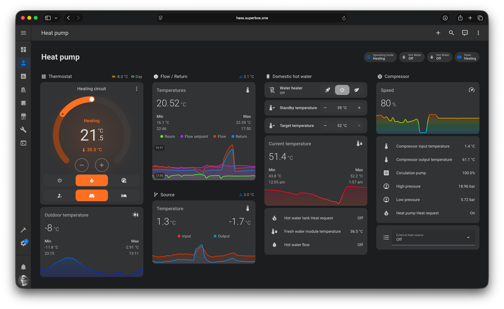
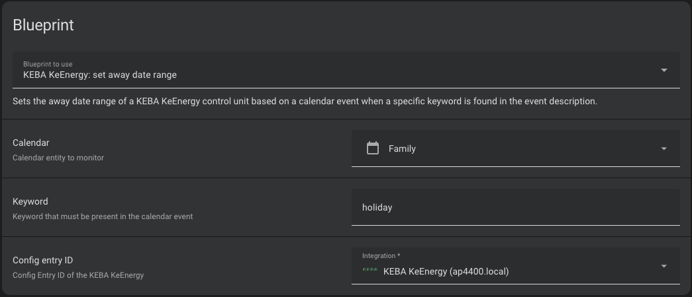
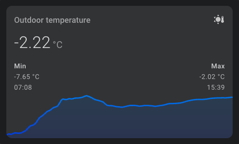

# KEBA KeEnergy

The **KEBA KeEnergy** integration connects Home Assistant to heat pumps with a KEBA KeEnergy control unit. It reads
the values of the control unit, the heat pumps, heating circuits, hot water tanks, buffer tanks, solar circuits,
external heat sources and photovoltaics from the local Web HMI and lets you change operating modes, target
temperatures, heating curves and more.

:::note[Unofficial integration]

This is an unofficial community integration. It is not affiliated with or supported by KEBA or the manufacturer of
your heat pump. For support, open an [issue](https://github.com/superbox-dev/keba_keenergy/issues/new/choose).

:::



## Use cases

- Monitor temperatures, pressures, operating states and the energy consumption of your heat pump.
- Track the seasonal performance factor (SPF) of heating, cooling and hot water.
- Change the operating mode of the heating circuits or the hot water tank from a dashboard or an automation.
- Set the away date range from a calendar, e.g. for holidays.
- Use the excess energy of your photovoltaics system for heating and hot water.

## Supported devices

The integration works with heat pumps that provide a KEBA KeEnergy Web HMI. It is used with these manufacturers and
devices:

| Manufacturer                            | Tested control unit | Tested heat pump               |
|-----------------------------------------|---------------------|--------------------------------|
| [M-TEC](https://m-tec.at/)              | AP 420/H-A          | WPS-412-XHV                    |
|                                         | AP 440/H-A          | WPS26, WPS412, AHPA618, AHPC27 |
| [ino](https://www.ino-wp.de/)           | AP 440/H-A          | Bartl 4.0                      |
| [Windhager](https://www.windhager.com/) | AP 440/H-A          | Evo 9                          |

If your device works and is not in the list, or if it does not work, please open an
[issue](https://github.com/superbox-dev/keba_keenergy/issues/new/choose).

The integration creates a device for the control unit and one for each heat pump, heating circuit, solar circuit,
hot water tank, buffer tank, external heat source, switch valve, passive cooling and photovoltaics system of your
setup. All devices are linked to the control unit.

## Prerequisites

- Home Assistant 2026.9.4 or newer with [HACS](https://hacs.xyz/) installed.
- Network access from Home Assistant to the Web HMI of the control unit.
- The username and password of the Web HMI, if the Web HMI requires a login (newer software versions).

## Installation

[][redirect-hacs]

1. Install the integration with HACS (search for "KEBA KeEnergy"). For a manual installation, copy the
   `custom_components/keba_keenergy` directory of the
   [latest release](https://github.com/superbox-dev/keba_keenergy/releases/latest) into the `custom_components`
   directory of your Home Assistant configuration.
2. Restart Home Assistant.

[redirect-hacs]: https://my.home-assistant.io/redirect/hacs_repository/?owner=superbox-dev&repository=keba_keenergy&category=integration

## Configuration

Home Assistant discovers AP 440 control units in your network automatically. To add the **KEBA KeEnergy**
integration manually, use this My button:

[][redirect-config-flow]

Or go to **Settings** → **Devices & services**, select **+ Add integration** and search for **KEBA KeEnergy**.

| Parameter               | Description                                                                                                  |
|-------------------------|--------------------------------------------------------------------------------------------------------------|
| Host                    | The hostname or IP address of the Web HMI, without protocol and port, e.g. `10.0.0.100` or `ap4400.local`.   |
| Uses an SSL certificate | Enable it if the Web HMI is only reachable with `https://`. Self-signed certificates are accepted.           |
| Username                | The username of the Web HMI. Only asked if the Web HMI requires a login.                                     |
| Password                | The password of the Web HMI. Only asked if the Web HMI requires a login.                                     |

To change the host or the credentials later, select **Reconfigure** in the menu of the integration entry. If the
Web HMI rejects the credentials, Home Assistant asks you to enter them again. If a configured control unit is
discovered with a new IP address, Home Assistant updates the host automatically. A configured hostname is kept.

[redirect-config-flow]: https://my.home-assistant.io/redirect/config_flow_start/?domain=keba_keenergy

## Options

To change the options, go to **Settings** → **Devices & services** → **KEBA KeEnergy** and select **Configure**.

| Option                            | Default | Description                                                                         |
|-----------------------------------|---------|-------------------------------------------------------------------------------------|
| Scan interval                     | 20      | Time in seconds between two updates, at least 20.                                   |
| Control unit update multiplier    | 1       | Update the values of the control unit only every n-th scan interval (1 to 180).     |
| `<Device>` update multiplier      | 1       | Same for each device type of your setup, e.g. heat pump or hot water tank.          |

The update multipliers are only shown for the device types of your setup. If all multipliers have a common divisor,
the integration multiplies the scan interval by it and divides the multipliers, e.g. a scan interval of 20 with the
multipliers 2 and 4 is saved as a scan interval of 40 with the multipliers 1 and 2.

## Supported functionality

The entities depend on the setup of your heat pump. Values that your control unit or software version does not
provide are not created. Changes are written to the control unit, see [Known limitations](#known-limitations).

### Control unit

- **Select**: operating mode
- **Sensors**: outdoor temperature, operating mode, CPU and temporary memory usage (diagnostic), write operations
  this week (diagnostic), flash erase counter (diagnostic)

### Heat pump

- **Sensors**: state and substate, temperatures of flow, return flow, source inlet and
  outlet, compressor inlet and outlet, condensation and evaporation, superheat, expansion valve position, pressures,
  pump, fan and compressor speeds
- **Energy sensors**: electrical, heating and hot water power, coefficient of performance, thermal energy and
  electricity consumption of heating, cooling and hot water, seasonal performance factor (SPF), consumption from
  PV surplus
- **Statistics**: operating hours, maximum runtime and activation counter, also for PV surplus
- **Binary sensors**: compressor, heat request, source, source actuator, source pressure, three-phase, frequency
  inverter, using PV surplus
- **Number and switch**: compressor power limit at night

### Heating circuit

- **Climate**: HVAC mode (auto, heat or cool, off), target room temperature (changes the offset) and the presets
  auto, day, night, party and, for heating circuits, away. The HVAC action shows heating, defrosting or preheating
  (pre-run of the heat pump) while the heating circuit requests heat and a heat pump is in this state, cooling while
  it requests cooling and idle otherwise.
- **Numbers**: target room temperatures (day, night, away, offset, PV surplus), heating and cooling limits,
  heating and cooling curve offset and slope
- **Selects**: operating mode, heating curve, cooling curve
- **Switches**: use PV surplus, use heating curve table, use cooling curve table (only for cooling circuits, a
  heating and cooling circuit uses one setting for both and only has **Use heating curve table**)
- **Sensors**: room temperature and humidity, dew point, flow and return flow temperatures, mixer, pump speed,
  heat and cool request, the current setpoints
- **Binary sensor**: pump

### Hot water tank and buffer tank

- **Water heater**: operating mode (off, on, heat up and, for the hot water tank, schedule) and target temperature
- **Numbers**: target and standby temperatures, PV surplus target temperature and hysteresis
- **Select and switch**: operating mode, use PV surplus
- **Sensors**: current temperatures, fresh water module and circulation return temperature
- **Binary sensors**: heat request, cool request, hot water flow, circulation pump

### Solar circuit, external heat source, passive cooling, switch valve and photovoltaics

- **Solar circuit**: collector and consumer temperatures, pump speeds, power and energy, target temperatures,
  operating mode, priority switch
- **External heat source**: operating mode (off, on and, for an external heat source with emissions, flue), target
  temperature, statistics, use PV surplus and minimum runtime
- **Passive cooling**: temperature, switch valve position, mixer and circulation pump
- **Switch valve**: position
- **Photovoltaics**: excess power, daily and total energy, PV surplus

## Actions

### `keba_keenergy.set_away_date_range`

Sets the away period of all heating circuits. During the away period, the heating circuits use the target room
temperature (away).

| Field          | Description                                         |
|----------------|-----------------------------------------------------|
| `config_entry` | The KEBA KeEnergy integration entry.                |
| `start_date`   | First day of the away period, e.g. `2026-01-01`.    |
| `end_date`     | Last day of the away period, e.g. `2026-01-14`.     |

A date with time, e.g. `2026-01-01T08:00:00`, is accepted too, only the date is used.

### `keba_keenergy.set_heating_curve_points`

Sets the points of a heating curve. If the heating curve already has these points, nothing is written.

| Field           | Description                                                                                        |
|-----------------|----------------------------------------------------------------------------------------------------|
| `config_entry`  | The KEBA KeEnergy integration entry.                                                               |
| `heating_curve` | The name of the heating curve as shown in the heating curve select, e.g. `HC1` or `HC FBH`.        |
| `points`        | 1 to 16 points, each with an `outdoor` (-40 to 40 °C) and a `flow` (10 to 90 °C) temperature.      |

```yaml
action: keba_keenergy.set_heating_curve_points
data:
  config_entry: 0123456789abcdef0123456789abcdef
  heating_curve: HC1
  points:
    - outdoor: 20
      flow: 20
    - outdoor: 0
      flow: 30
    - outdoor: -20
      flow: 40
```

## Examples

The entity IDs start with `<platform>.keba_keenergy_` followed by the serial number of the control unit, the device
type and the entity key. The examples use the serial number `12345678`, replace it with the one of your device. You
find the entity ID in the entity settings.

### Set the away date range from a calendar

This [blueprint][away-range-blueprint] sets the away date range when a calendar event with a keyword in its
description starts, e.g. a holiday.



[away-range-blueprint]: https://raw.githubusercontent.com/superbox-dev/keba_keenergy/refs/heads/main/blueprints/automation/keba_keenergy/set_away_date_range.yaml

### Temperature delta templates

A template sensor for the delta between the source input and output temperature of the heat pump:

```yaml
template:
  - sensor:
      - name: Heat pump source temperature delta
        unique_id: heat_pump_source_temperature_delta
        state: >-
          
          
          {{ (input - output)|round(2) }}
        icon: mdi:thermometer
        unit_of_measurement: °C
        device_class: temperature
        state_class: measurement
```

The same works for the flow and return flow temperature of the heat pump or of the heating circuits:

```yaml
template:
  - sensor:
      - name: Heat pump flow and return temperature delta
        unique_id: heat_pump_flow_and_return_temperature_delta
        state: >-
          
          
          {{ (flow - return_flow)|round(2) }}
        icon: mdi:thermometer
        unit_of_measurement: °C
        device_class: temperature
        state_class: measurement
```

### Outdoor temperature chart

A chart of the outdoor temperature with the [Mini Graph Card](https://github.com/kalkih/mini-graph-card). The color
of the line follows the temperature.



```yaml
type: custom:mini-graph-card
name: Outdoor temperature
entities:
  - entity: sensor.keba_keenergy_12345678_outdoor_temperature
    name: Temperature
line_width: 3
hour24: true
points_per_hour: 12
show:
  labels: false
  extrema: true
color_thresholds:
  - value: -10
    color: "#0020E7"
  - value: 0
    color: "#008EE7"
  - value: 10
    color: "#00E7DD"
  - value: 20
    color: "#00E758"
  - value: 25
    color: "#BEE700"
  - value: 30
    color: "#E79700"
  - value: 35
    color: "#E73700"
```

## Data updates

The integration polls the Web HMI every 20 seconds by default, see [Options](#options). With the update multipliers,
slowly changing values, e.g. of the control unit, can be updated less often to reduce the load on the Web HMI.

The devices and entities are detected when the integration is set up. After you change the setup of your heat pump,
reload the integration. Devices that the control unit no longer provides, e.g. a removed buffer tank, are removed
with their entities.

With every update, the integration also reads whether the control unit uses the sensors (the message ID of a sensor,
`0` means the sensor is in use). Like the Web HMI, the integration distinguishes two cases of sensors that are not in
use:

- **Not configured** (message ID `10`): the Web HMI hides the sensor. Its entity is not created, an existing entity is
  removed when the integration is set up. After you configure the sensor, reload the integration.
- **Invalid value** (any other message ID), e.g. a sensor that is not connected: the Web HMI shows `-`. The sensor is
  unknown and has a value again with the next update after the sensor is connected.

The climate and water heater entities are still created, but leave out the current temperature and humidity (e.g.
`current_temperature`) if their sensor is not in use.

## Known limitations

- The control unit stores every change in its flash memory, which only allows a limited number of write operations.
  Avoid automations that change values very often. If more than 30 changes are written to a control unit in a week,
  Home Assistant shows a repair issue for this control unit. See
  [Issue #23](https://github.com/superbox-dev/keba_keenergy/issues/23).
- The diagnostic sensor **Write operations this week** of the control unit counts the write operations since Monday.
  Its attribute `writes` shows how often each value was written, e.g. `heat_circuit_1.target_temperature_offset`,
  `system.operating_mode` or `heating_curve_points.HC1`. A change of several values at once (e.g. the away date range
  of all heating circuits) counts once in the sensor, but once for each value in `writes`. Switching a hot water tank
  to heat up is not counted.
- The diagnostic sensor **Flash erase counter** of the control unit (disabled by default) shows the long-term wear of
  the flash memory, also from changes in the Web HMI or on the display. It is the highest erase count of a flash
  block and rises slowly, not with every write operation.
- Changes of numbers, target temperatures and the climate entity are written after a short delay, so several quick
  changes result in one write operation.
- The control unit does not provide which heat pump supplies which heating circuit. With several heat pumps, the
  HVAC action of a heating circuit with a heat request follows any heat pump, e.g. it shows heating while one heat
  pump heats hot water.
- The HVAC action of a heating circuit only shows heating while a heat pump heats. A heating circuit that is supplied
  by a buffer tank while the heat pumps are in standby shows idle. If your setup has a buffer tank, please open an
  [issue](https://github.com/superbox-dev/keba_keenergy/issues/new/choose) with the history of the heat request of the
  heating circuit and the heat pump state, so that this case can be supported.
- Only values that the Web HMI provides are supported. Missing values have to be added to the
  [KEBA KeEnergy API](https://github.com/superbox-dev/keba_keenergy_api) first.

## Troubleshooting

- **Failed to connect**: enter the hostname or IP address without protocol and port. Correct: `10.0.0.100`.
  Incorrect: `10.0.0.100:443` or `https://ap4400.local`. If the Web HMI only works with `https://`, enable
  **Uses an SSL certificate**.
- **Invalid authentication**: check that you can log in to the Web HMI in the browser with the same username and
  password.
- **Missing entities**: entities are only created for values that your control unit provides. Reload the integration
  after a change of your heat pump setup.
- **Unknown sensors**: the control unit reports the value of the sensor as not valid, e.g. it is not connected. The
  Web HMI shows `-` instead of a value. The message IDs of the sensors are in the [diagnostics][debug-logs].
- **Missing sensors**: sensors that are not configured on the control unit (message ID `10`) are not created, the
  Web HMI hides them as well.

If the problem persists, [enable debug logging][debug-logs], reproduce the problem and open an
[issue](https://github.com/superbox-dev/keba_keenergy/issues/new/choose) with the log, the
[diagnostics][debug-logs] (**Download diagnostics** in the menu of the integration entry, the host, the credentials
and the serial number are removed), the Web HMI software version
(**Service** → **Systeminformationen** → **Software**) and the device hardware name
(**Service** → **Systeminformationen** → **Gerät**).

[debug-logs]: https://www.home-assistant.io/docs/configuration/troubleshooting/#debug-logs-and-diagnostics

## Removing the integration

This integration follows standard integration removal.

1. Go to **Settings** → **Devices & services** and select **KEBA KeEnergy**.
2. Select the three dots ⋮ of the entry and select **Delete**.
3. To remove the files as well, remove the integration in HACS and restart Home Assistant.
